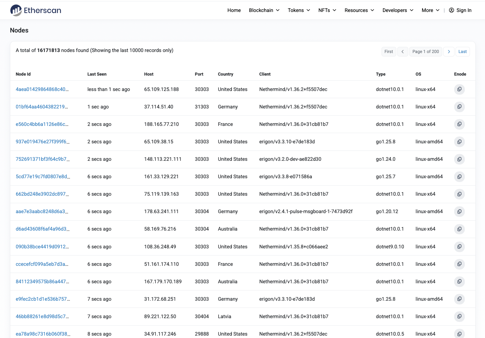
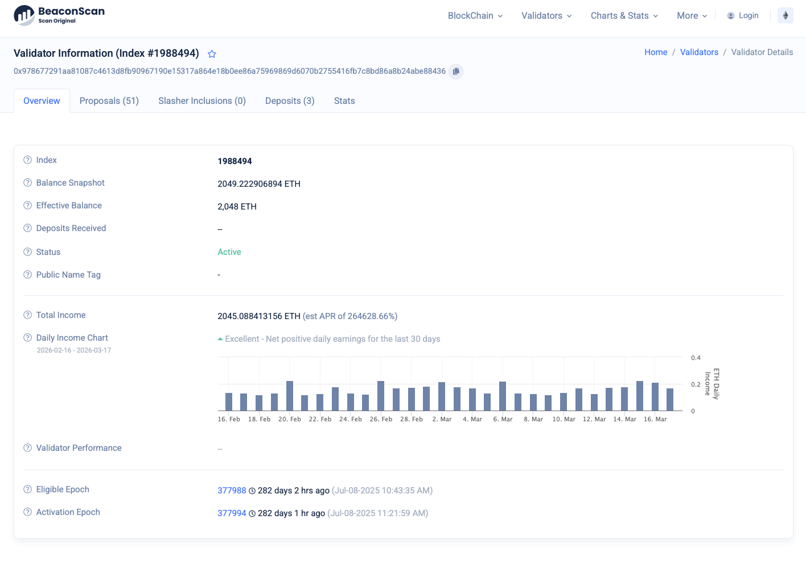

# Blockchain Validators

Every validators/node is publicly displayed on the explorer:

* [Ethereum Nodes](https://etherscan.io/nodetracker/nodes);
* [Solana Validators](https://solscan.io/validator).
* [MultiverX Validators](https://explorer.multiversx.com/validators);

You can check on the explorer the nodes of every blockchain.

:::note
We call `nodes` or `validators` the computers who participate in the blockchain to execute transactions.
The more available nodes, the more decentralized the blockchain is.
:::

Let's stick to the Ethereum. Go to the [Nodes Section](https://etherscan.io/nodetracker/nodes).

Observe the nodes public information:

* Public Key
* Last Seen
* Host
* Port
* Country
* Client
* Type
* OS

## Node details

[BeaconScan](https://beaconscan.com/validators) offers details on each node participant to the blockchain.

## Practice

* Open 3 different nodes on [Ethereum Explorer](https://etherscan.io/nodetracker/nodes) and inspect them;
* Open 3 different nodes on [Solana Explorer](https://solscan.io/validator) and inspect them;
