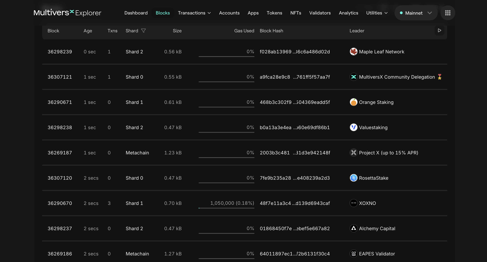
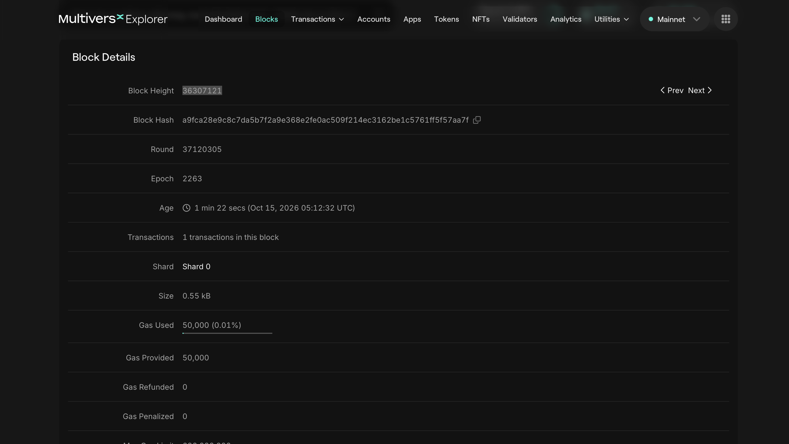

# Blocks in Blockchain

For simplicity, we will use MultiversX blockchain and MultiversX [Explorer](https://explorer.multiversx.com/).

## Notarization of blocks

Inspect the image below:

We can observe 4 blocks from 1 second ago for 4 different shards: Shard0, Shard1, Shard2, Metachain.
These shards are sub-blockchains and enable MultiversX to scale. You can read more about sharding [here](https://docs.multiversx.com/technology/adaptive-state-sharding).

We can observe 4 more blocks from 2 seconds ago and 1 block from 0 seconds ago. That's because each shard outputs a block every 0.6 seconds.

:::note
We previously saw that _every second starts new round_, but _not necessarly a new block gets notarized_.
In this case all the blocks successfully passed the consensus round and got notarized.
:::

## Block details

[Here](https://explorer.multiversx.com/blocks/a9fca28e9c8c7da5b7f2a9e368e2fe0ac509f214ec3162be1c5761ff5f57aa7f) is the link for one of the blocks in the previous image (Block Height: 36307121).

Observe the block details:

- Round
- Epoch
- Age (timestamp)
- Shard

We will talk about the other fields in the next section.

## Practice

1. Go to the MultiversX [Explorer](https://explorer.multiversx.com/) and check more blocks from different shard;
2. Go to the Ethereum [Explorer](https://etherscan.io/) and check some blocks details.
