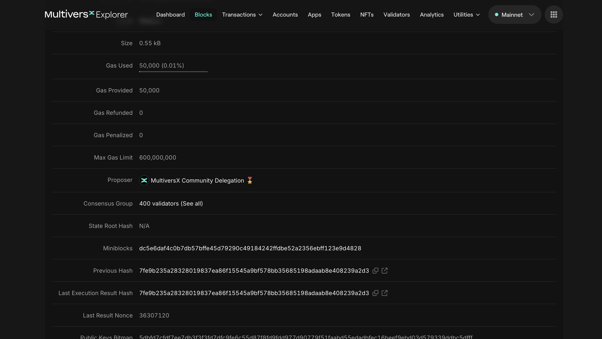

# Consensus Group

We will continue with the same [block](https://explorer.multiversx.com/blocks/a9fca28e9c8c7da5b7f2a9e368e2fe0ac509f214ec3162be1c5761ff5f57aa7f) from the previous section (Block Height: 36307121).

Observe the field **Consensus Group**:

There are 400 validators which execute every transaction in this block.
If you click on the **400 validators (See all)** button you will see 400 public keys, which are links to all the 400 nodes that participated in consensus.

## Practice

- Open 3 different blocks in 3 different tabs. Observe that every time there is another consensus group.
Why do you think the system is designed this way?
- Open 3 different blocks in 3 different tabs on Ethereum [Explorer](https://etherscan.io/). Observe that every time there is another leader.
