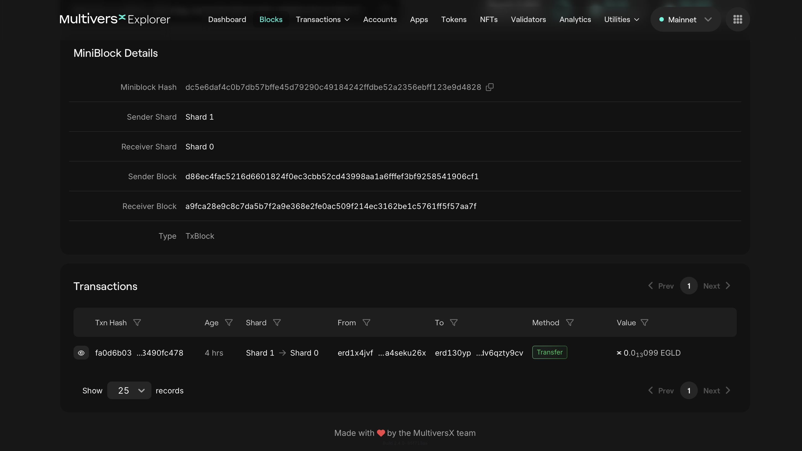
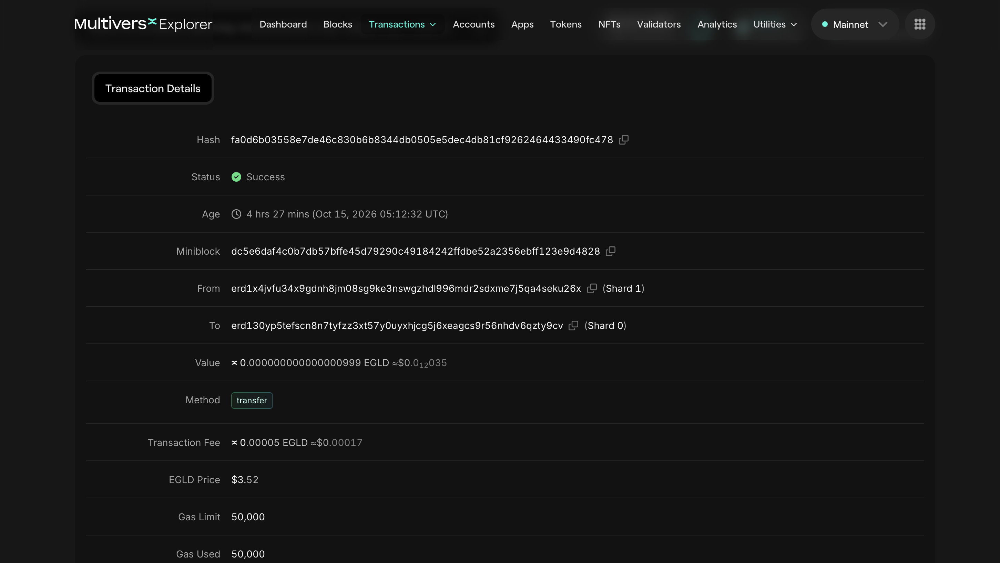

# Transactions

We will continue with the same [block](https://explorer.multiversx.com/blocks/a9fca28e9c8c7da5b7f2a9e368e2fe0ac509f214ec3162be1c5761ff5f57aa7f) from the previous section (Block Height: 36307121).

Observe the field **Transactions**:

We can see that there are 6 transactions in this group.

## Miniblocks

Transactions are grouped in **miniblocks**.
Each miniblock is a category with `Shard_source - Shard_destionation`.

So, for the first miniblock we have 1 transaction from Shard1 to Shard0:

## Transaction details

Observe the fields:

- Status: Success;
- Age: timestamp;
- Miniblock: the one we previously disscussed about;
- From: The user who created the transaction;
- To: The destination of the transaction;
- Value: The number of EGLD (MultiversX native token) sent in this transaction

There are more fields in this transaction, but we will discuss about it in a further section.

## Practice

- Open 3 different transactions in 3 different tabs. Inspect the fields.
- Open 3 different transactions in 3 different tabs on Ethereum [Explorer](https://etherscan.io/). Inspect the fields.
